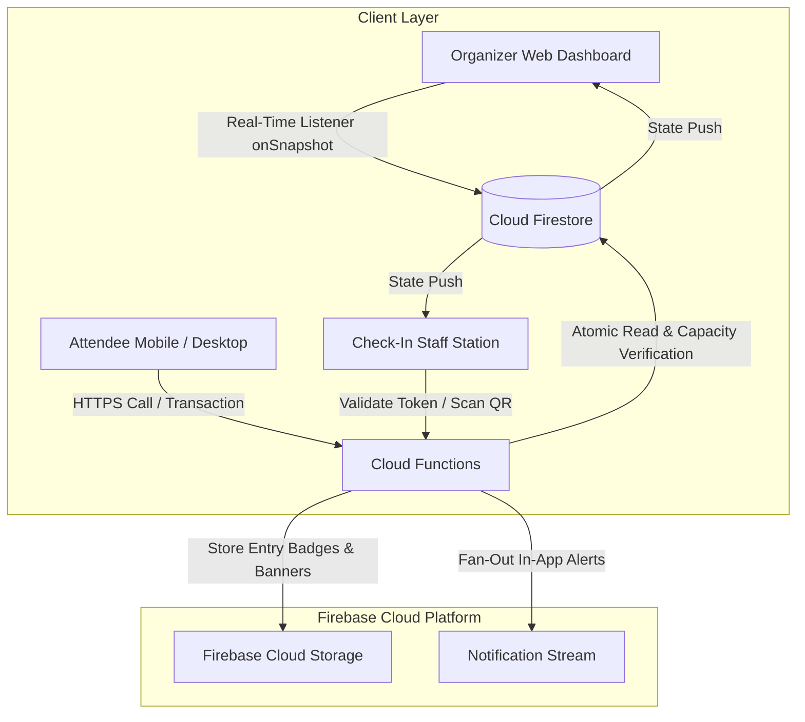

# EventFlow: Real-Time Cloud-Based Event Planning & RSVP Tracker

[](https://react.dev/)
[](https://firebase.google.com/)
[](https://firebase.google.com/docs/firestore)
[](https://firebase.google.com/docs/functions)
[](https://www.typescriptlang.org/)
[](LICENSE)

> **EventFlow** is an industry-oriented, production-grade cloud application demonstrating real-time database synchronization, serverless transactions, atomic capacity race-condition mitigation, cryptographic token verification, and QR-based venue check-in.

---

## 1. Executive Summary & Problem Statement

### The Problem
Traditional event coordination relies on static forms (e.g., Google Forms) or batch-processed registration tables. This results in:
1. **Capacity Overbooking Race Conditions:** Multiple users submitting concurrent requests for the final remaining seat exceed venue fire code limits.
2. **Lagged Dashboards:** Organizers must manually refresh to see attendance figures.
3. **Impersonal Public Links:** Unauthenticated open links enable spam responses, proxy registrations, and duplicate submissions.
4. **Slow Manual Check-In:** Registration staff search through static spreadsheets, causing check-in bottlenecks and duplicate badge entries.

### The EventFlow Solution
**EventFlow** implements a modern cloud architecture powered by **React**, **Google Cloud Firestore**, **Firebase Authentication**, **Cloud Functions**, and **Firebase Hosting**:
- **Real-Time Data Streaming:** Uses Firestore snapshot streams (`onSnapshot`) to update organizer KPIs in under 200ms without manual page refreshes.
- **Server-Side Atomic Transactions:** RSVP writes execute inside transactions that atomically verify remaining capacity and place overflows into a strict FIFO waitlist.
- **Cryptographic Token Verification:** Each invitee receives an unguessable 32-character hex token and QR code enabling 1-click RSVP without mandatory account creation.
- **On-Site Fast Check-In Desk:** Validates attendee admission passes in real-time, logs entry timestamps, and strictly blocks duplicate badges.

---

## 2. Cloud Architecture



---

## 3. Technology Stack

| Layer | Technology | Purpose |
|---|---|---|
| **Frontend Framework** | React 19 + TypeScript + Vite | High-performance SPA with strict type safety |
| **Routing** | React Router v7 | Protected route guards and role-based redirects |
| **Styling & Design** | Modern Vanilla CSS Design System | Clean, high-contrast, professional **LIGHT THEME** (Linear / Stripe style) |
| **Real-Time Cloud DB** | Google Cloud Firestore | Document database with reactive real-time snapshot streams |
| **Authentication** | Firebase Authentication | Email/password auth, role-based authorization (RBAC) |
| **Serverless Backend** | Firebase Cloud Functions (Node.js) | Atomic transactions, token minting, FIFO waitlist promotion |
| **Cloud Storage** | Firebase Cloud Storage | High-durability hosting for event banners and media |
| **Visualizations** | Recharts | Responsive RSVP distribution and capacity utilization charts |
| **Pass Generation** | QRCode | Cryptographic client & server QR pass generation |
| **Icons** | Lucide React | Modern, lightweight UI iconography |

---

## 4. Firestore Data Model

The Firestore database follows a clean, decoupled schema:

### Collections Hierarchy
```
/users/{uid}
  ├── name: string
  ├── email: string
  ├── role: "organizer" | "attendee"
  └── createdAt: ISO timestamp

/events/{eventId}
  ├── title: string
  ├── description: string
  ├── eventType: "Workshop" | "Conference" | "Seminar" | ...
  ├── startAt: ISO timestamp
  ├── endAt: ISO timestamp
  ├── venue: string
  ├── onlineLink: string (optional)
  ├── capacity: number
  ├── rsvpDeadline: ISO timestamp
  ├── bannerUrl: string
  ├── status: "draft" | "published" | "completed" | "cancelled"
  ├── organizerId: string (uid)
  ├── organizerName: string
  └── createdAt / updatedAt: ISO timestamps

/events_invites/{eventId}/invites/{inviteId}
  ├── name: string
  ├── email: string
  ├── phone: string
  ├── role: string
  ├── company: string
  ├── token: string (secure 32-hex random token)
  ├── status: "pending" | "yes" | "maybe" | "no" | "waitlist" | "checked-in"
  ├── plusOnesAllowed: number
  ├── plusOnesCount: number
  ├── waitlistPosition: number | null
  └── createdAt: ISO timestamp

/events_rsvps/{eventId}/rsvps/{inviteId}
  ├── token: string
  ├── name: string
  ├── email: string
  ├── answer: "yes" | "maybe" | "no" | "waitlist"
  ├── guests: number
  ├── timestamp: ISO timestamp
  └── updatedAt: ISO timestamp

/announcements/{announcementId}
  ├── eventId: string
  ├── eventTitle: string
  ├── title: string
  ├── message: string
  ├── authorName: string
  └── createdAt: ISO timestamp

/notifications/{notificationId}
  ├── userId: string
  ├── eventId: string
  ├── type: "RSVP_CONFIRMED" | "WAITLIST_PROMOTED" | "ANNOUNCEMENT" | ...
  ├── title: string
  ├── message: string
  ├── read: boolean
  └── createdAt: ISO timestamp

/events_checkins/{eventId}/checks/{inviteId}
  ├── eventId: string
  ├── inviteId: string
  ├── attendeeName: string
  ├── attendeeEmail: string
  ├── method: "qr" | "manual"
  └── timestamp: ISO timestamp
```

---

## 5. Capacity Management & Safe Concurrency

### The Overbooking Race Condition
When Capacity = 100 and Confirmed Attendees = 99:
Two users (User A and User B) click "GOING" at the exact same millisecond. If implemented naively with separate read and write steps:
1. User A reads count: 99 (valid < 100).
2. User B reads count: 99 (valid < 100).
3. User A writes RSVP (+1) $\rightarrow$ Count = 100.
4. User B writes RSVP (+1) $\rightarrow$ Count = 101 (**Overbooking failure!**).

### EventFlow Transaction Logic (`runTransaction`)
EventFlow enforces atomic server-side isolation:
```typescript
await runTransaction(db, async (transaction) => {
  // 1. Transaction locks and reads current Event capacity
  const eventSnap = await transaction.get(eventRef);
  const capacity = eventSnap.data().capacity;

  // 2. Read all existing RSVP records in this event
  const currentOccupiedSeats = ...; // sum of confirmed yes + guests

  // 3. Atomically evaluate capacity
  if (currentOccupiedSeats + requestedSeats > capacity) {
    finalStatus = 'waitlist'; // Overbooked requests cascade to waitlist
  } else {
    finalStatus = 'yes';
  }

  // 4. Atomically commit both RSVP document and Invite status
  transaction.set(rsvpRef, { answer: finalStatus, ... });
  transaction.update(inviteRef, { status: finalStatus, ... });
});
```

### FIFO Waitlist Promotion
When a confirmed attendee cancels (`yes` $\rightarrow$ `no` or `maybe`):
1. The transaction calculates freed seat count.
2. The transaction inspects the waitlist collection, ordering by `timestamp ASC` (First In, First Out).
3. The earliest registered waitlist attendee is automatically promoted to `yes`.
4. A `WAITLIST_PROMOTED` in-app notification is dispatched to the promoted attendee.

---

## 6. Live Step-by-Step Demo Flow

To demonstrate EventFlow's real-time capabilities for interviews or project evaluations:

1. **Step 1: Open Organizer View (Browser 1)**
   - Navigate to `http://localhost:5173/organizer`
   - Observe the live KPI cards: **Going = 84**, **Capacity = 100**, and the animated green **Live** badge.

2. **Step 2: Attendee A RSVPs (Browser 2 - Incognito)**
   - Open Attendee A's unique RSVP link:  
     `http://localhost:5173/rsvp?e=event-cloud-workshop&t=token-aarav-sharma-1234`
   - Notice: **No login required**! The page loads Aarav Sharma's invitation.
   - Click **✓ Going** and select **+1 guest**.
   - Instantly, an entry badge with a scannable **QR code** is generated!

3. **Step 3: Observe Instant Live Update on Organizer View (Browser 1)**
   - Without refreshing Browser 1, observe the **Going** counter increment in real-time.
   - The Recent Activity feed immediately displays: *"Aarav Sharma updated RSVP"*.

4. **Step 4: Attendee B Changes Answer (Browser 3)**
   - Open Attendee B's link:  
     `http://localhost:5173/rsvp?e=event-cloud-workshop&t=token-rahul-verma-9012`
   - Click **? Maybe** $\rightarrow$ Observe the **Maybe** counter increment on Browser 1.

5. **Step 5: Test the Check-In Desk**
   - Open `http://localhost:5173/checkin`
   - Click the simulator button: **Scan Aarav**
   - Attendee card displays: **ATTENDEE FOUND** (Aarav Sharma, +1 guest).
   - Click **Confirm Check-In**.
   - Result: **✓ Checked In at [Time]**.
   - Click Check-In again $\rightarrow$ System warns: **Duplicate check-in blocked!**

---

## 7. Local Development Setup

### Prerequisites
- Node.js (v18.0.0 or higher)
- npm or yarn

### 1. Clone & Install Dependencies
```bash
git clone https://github.com/your-username/Real-Time-Cloud-Event-RSVP-Tracker.git
cd Real-Time-Cloud-Event-RSVP-Tracker

# Install dependencies
npm install
```

### 2. Configure Environment Variables
Copy `.env.example` to `.env`:
```bash
cp .env.example .env
```
Fill in your Firebase project parameters from [Firebase Console](https://console.firebase.google.com/) -> Project Settings:
```env
VITE_FIREBASE_API_KEY=your_api_key
VITE_FIREBASE_AUTH_DOMAIN=your_project.firebaseapp.com
VITE_FIREBASE_PROJECT_ID=your_project_id
VITE_FIREBASE_STORAGE_BUCKET=your_project.firebasestorage.app
VITE_FIREBASE_MESSAGING_SENDER_ID=your_sender_id
VITE_FIREBASE_APP_ID=your_app_id
```

### 3. Run Automated Tests
```bash
npm test
```
*Executes all 6 validation tests: Token security, plus-one calculation, capacity limit checks, FIFO waitlist promotion, duplicate check-in blocking, and CSV parsing.*

### 4. Start the Application Locally
```bash
npm run dev
```
Open [http://localhost:5173](http://localhost:5173) in your browser.

---

## 8. Firebase Emulator Suite (Local Cloud Simulation)

To run without connecting to production cloud services:
```bash
# Install Firebase CLI if not already installed
npm install -g firebase-tools

# Login to Firebase
firebase login

# Start Auth, Firestore, and Functions Emulators
firebase emulators:start
```
Emulator Ports:
- Emulator UI: `http://localhost:4000`
- Firestore: `localhost:8080`
- Auth: `localhost:9099`
- Functions: `localhost:5001`

---

## 9. Production Deployment

### Build the Optimized Frontend
```bash
npm run build
```

### Deploy to Firebase Hosting & Cloud Functions
```bash
firebase deploy
```
*Deploys static build to Firebase Hosting CDN, applies `firestore.rules` and `storage.rules`, and deploys serverless Cloud Functions.*

---

## 10. Placement & Technical Interview Talking Points

When presenting this project to interviewers or professors, highlight these cloud engineering decisions:
1. **Event-Driven Architecture:** Why `onSnapshot` was chosen over HTTP polling to minimize egress costs and deliver low-latency UX.
2. **ACID Transaction Guarantees:** How race conditions are prevented at the database engine level using `runTransaction`.
3. **Defense-in-Depth Security:** How unauthenticated public writes are blocked in `firestore.rules` while allowing public token-based RSVP through trusted transactions.
4. **Light Theme SaaS UI:** Built with deliberate whitespace, typography hierarchy, and subtle micro-interactions mirroring tools like Linear and Stripe.

---

## 11. License
This project is open-source and available under the [MIT License](LICENSE).
